I build full-stack TypeScript software for business workflows, internal tools, infrastructure automation, and practical AI. My work starts with real operations problems: records that drift, approvals that stall, and computers that need support.

  <a href="https://novadev.tech">Portfolio</a> ·
  <a href="https://linkedin.com/in/nova315">LinkedIn</a> ·
  <a href="mailto:mohamed@novadev.tech">Email</a> ·
  <a href="https://novadev.tech/resume">Résumé</a>

